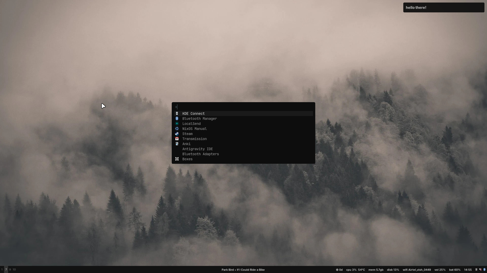
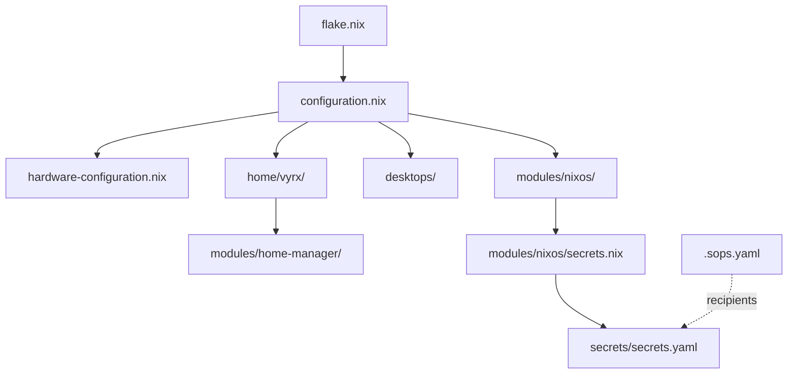

# nixos-btw



My NixOS config. It sets up two desktops:

- **Sway** (with custom apps)
- **Niri** (with Noctalia)

It probably won't work on your machine as is, but poke around and steal whatever is useful. That's mostly why I made it public.

```bash
git clone https://github.com/vyrx-dev/nix-config && cd nix-config
# edit hardware-configuration.nix, hostnames, and display outputs first
sudo nixos-rebuild switch --flake .
```

This ships `nh`, so after the first switch you can rebuild with `nh os switch`, or `nh os switch --update` to bump the flake inputs too.

Here's how the pieces fit together:



In short: `modules/nixos/` holds one system module per concern, `desktops/` has the Sway and Niri setups (`shared.nix` is the common Wayland bits), `home/vyrx/` feeds `modules/home-manager/`, and `secrets/` is age-encrypted with sops-nix.

> [!WARNING]
> Never put passwords or API tokens in Nix files. The Nix store is world-readable.

## Secrets (sops-nix)

`secrets/secrets.yaml` is encrypted with [sops](https://getsops.io) using [age](https://github.com/FiloSottile/age). The list of who can decrypt it lives in `.sops.yaml`. Those are my keys, so swap in yours if you fork.

The machine can read your age key from two places:

- `/var/lib/sops-nix/key.txt`: used by the system at boot to decrypt secrets. Required, set it up once per machine.
- `~/.config/sops/age/keys.txt`: used by you to edit secrets with `sops`. Optional.

Both hold the same key (one line starting with `AGE-SECRET-KEY-1`). `install -D` creates the folder and sets the owner and permissions for you:

```bash
# system key (needed for boot and activation)
sudo install -D -m600 -o root -g root <your-age-key> /var/lib/sops-nix/key.txt

# your key (needed to edit secrets)
install -D -m600 <your-age-key> ~/.config/sops/age/keys.txt
```

`<your-age-key>` is the path to a plain text file with that one key line in it. Then rebuild.

- Edit secrets: `sops secrets/secrets.yaml`
- Add a host: append its `ssh-to-age` key to `.sops.yaml`, then run `sops updatekeys secrets/secrets.yaml`

good luck.
