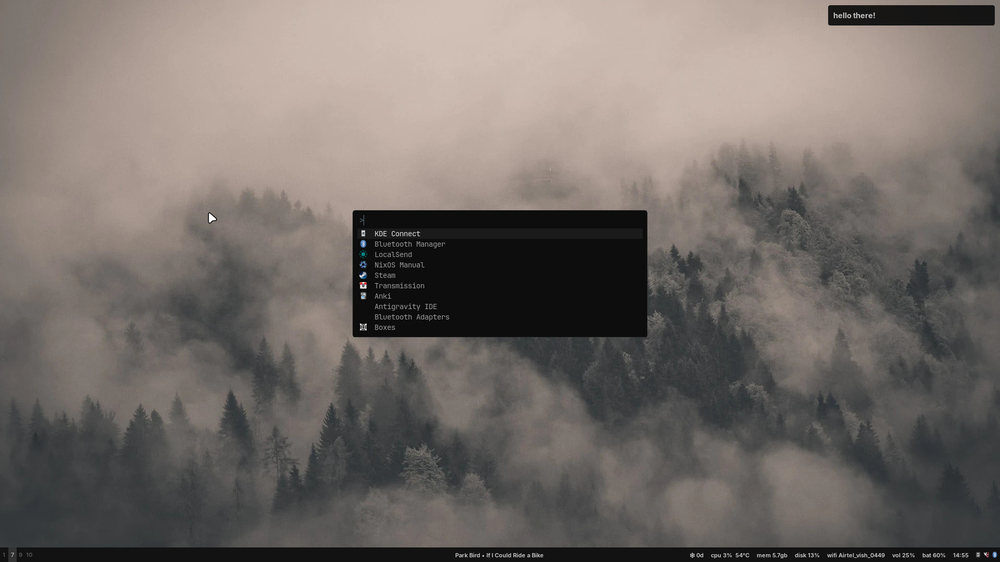
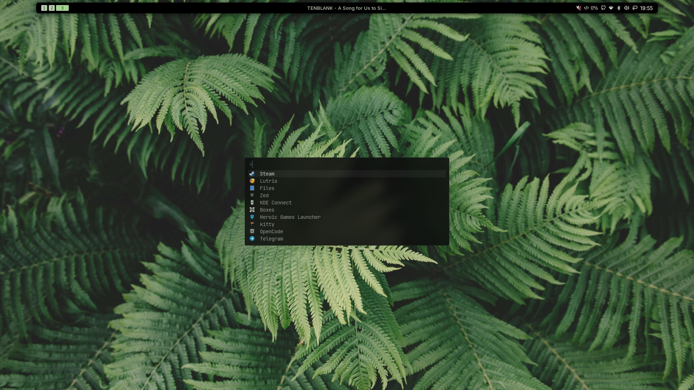

# nixos-btw

<table>
  <tr>
    <td width="50%"><a href="assets/sway.png"></a></td>
    <td width="50%"><a href="assets/niri.png"></a></td>
  </tr>
  <tr>
    <td align="center"><b>Sway</b></td>
    <td align="center"><b>Niri + Noctalia</b></td>
  </tr>
</table>

My NixOS config for one system (`nixos-btw`, user `vyrx`). Both desktops share the same Wayland and Home Manager base, so I can pick either one at login.

It probably won't work on your machine as-is. Poke around and take whatever is useful.

## What's inside

```
.
├── flake.nix                    inputs and the nixos-btw host
├── configuration.nix            host entry point
├── hardware-configuration.nix   disks, LUKS, swap (keep the one your install made)
├── modules/
│   ├── nixos/                   system: boot, nix, networking, users, secrets...
│   └── home-manager/            user: fish, waybar, niri, sway, scripts...
│       └── files/               dotfiles and scripts linked into ~
├── desktops/                    sway, niri, shared Wayland bits
├── home/vyrx/                   Home Manager entry point
└── secrets/                     age-encrypted sops vault
```

Never put passwords or API tokens in Nix files. The Nix store is world-readable.

## Fresh install

1. Install NixOS and boot the basic system. Keep the generated `/etc/nixos/hardware-configuration.nix`, it already has your disks, LUKS, and swap. Change the hostname, display outputs, and users to match your machine.

2. Clone the repo and put it at `/etc/nixos`. `nh` and `rebuild-nix` expect it there:

   ```bash
   git clone git@github.com:vyrx-dev/nix-config.git ~/nix-config
   sudo mv /etc/nixos /etc/nixos.generated
   sudo mv ~/nix-config /etc/nixos
   cp /etc/nixos.generated/hardware-configuration.nix /etc/nixos/hardware-configuration.nix
   ```

3. Restore the keys from your backup. The host key must be in place before the first switch. See [SOPS.md](SOPS.md#restore-after-a-reinstall).

4. Switch:

   ```bash
   cd /etc/nixos
   sudo nixos-rebuild switch --flake .
   ```

5. Check that secrets decrypted. The steps are in [SOPS.md](SOPS.md#verify-after-the-switch).

## Everyday

```bash
rebuild-nix   # stage /etc/nixos, then nh os switch
update-nix    # same, plus flake updates
```

(`rebuild-nix` and `update-nix` are fish aliases from my fish config. If you use it they are already defined, otherwise run `nh os switch` and `nh os switch --update`.)

To edit secrets, run `sops secrets/secrets.yaml`. Details are in [SOPS.md](SOPS.md).

good luck.
