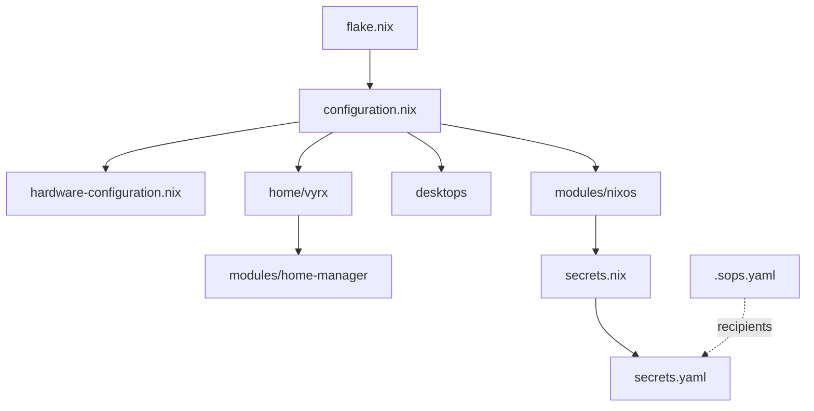
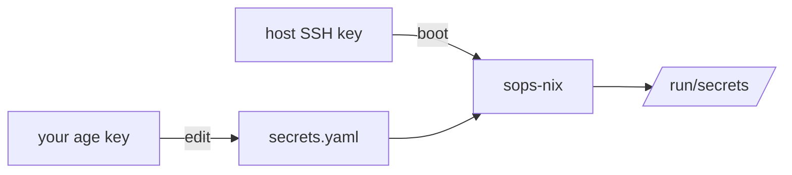

# nixos-btw


My NixOS config for a single laptop (host `nixos-btw`, user `vyrx`). It sets up two desktops:

- **Sway** (with custom apps)
- **Niri** (with Noctalia)

It probably won't work on your machine as is, but poke around and steal whatever is useful. That's mostly why I made it public.

## How it fits together



- `flake.nix`: inputs, and the single `nixos-btw` host output.
- `configuration.nix`: host entry point, imports everything else.
- `hardware-configuration.nix`: disks, LUKS, swap. Machine-specific, keep the one your own install generated.
- `modules/nixos/`: system modules, one per concern (boot, nix, packages, networking, ssh, secrets, ...).
- `desktops/`: Sway and Niri, plus `shared.nix` with the common Wayland bits.
- `home/vyrx/`: Home Manager entry point, pulls in `modules/home-manager/`.
- `modules/home-manager/`: user modules (fish, waybar, rmpc, scripts, ...).
- `modules/home-manager/files/`: dotfiles and scripts, symlinked into `~`.
- `secrets/`: age-encrypted vault, see [Secrets](#secrets-sops-nix).

> [!WARNING]
> Never put passwords or API tokens in Nix files. The Nix store is world-readable.

## Install (fresh machine)

1. Install NixOS normally and boot into a basic system.

2. Keep the `hardware-configuration.nix` that NixOS generated during the install. It already describes your disks, LUKS, and swap, so don't use the copy from this repo. Adjust the hostname, display outputs, and users instead.

3. Restore your backed-up secrets keys (see [Secrets](#secrets-sops-nix) for how to make these backups):

   ```bash
   # folder with your backup files, use the line for your shell
   KEYS=~/backups/nix-keys          # bash / zsh
   set KEYS ~/backups/nix-keys      # fish

   # host keypair, decrypts the vault at boot
   sudo install -D -m600 -o root -g root "$KEYS/ssh_host_ed25519_key"     /etc/ssh/ssh_host_ed25519_key
   sudo install -D -m644 -o root -g root "$KEYS/ssh_host_ed25519_key.pub" /etc/ssh/ssh_host_ed25519_key.pub

   # your personal age key, used to edit secrets
   install -D -m600 "$KEYS/keys.txt" ~/.config/sops/age/keys.txt
   ```

   The host key must be in place before the first switch. A freshly generated one does not match the vault.

4. Put the repo in place and switch. `nh` and the `rebuild-nix` alias expect it at `/etc/nixos`, so clone it there and keep your generated hardware file:

   ```bash
   # clone as yourself, then move it into place
   git clone git@github.com:vyrx-dev/nix-config.git ~/nix-config
   sudo mv /etc/nixos /etc/nixos.generated
   sudo mv ~/nix-config /etc/nixos

   # use the hardware file from your install, not the repo's
   cp /etc/nixos.generated/hardware-configuration.nix /etc/nixos/hardware-configuration.nix

   cd /etc/nixos
   sudo nixos-rebuild switch --flake .
   ```

5. Check that secrets decrypted:

   ```bash
   nix run nixpkgs#ssh-to-age -- -i /etc/ssh/ssh_host_ed25519_key.pub   # should print the &host key from .sops.yaml
   ls /run/secrets/                                                     # decrypted secrets
   ```

## Day to day

This ships `nh`, so after the first switch you rebuild with:

```bash
rebuild-nix   # stages changes in /etc/nixos, then nh os switch
update-nix    # the same, plus flake input updates
```

Without fish: `nh os switch` and `nh os switch --update`.

- Change a config or script: edit it in `/etc/nixos`, then `rebuild-nix`.
- Edit secrets: `sops secrets/secrets.yaml`.

## Secrets (sops-nix)

`secrets/secrets.yaml` is encrypted with [sops](https://getsops.io) using [age](https://github.com/FiloSottile/age). `.sops.yaml` lists the recipients allowed to decrypt it. Those are my keys, swap in yours if you fork.

The machine decrypts at boot with its SSH host key, which sops-nix imports as an age key. There is no separate system key file:

```nix
sops.age.sshKeyPaths = [ "/etc/ssh/ssh_host_ed25519_key" ];
```

You edit the vault from your shell with your personal age key at `~/.config/sops/age/keys.txt`.



### Back up these two

Without them you cannot decrypt the vault on a new machine:

1. `/etc/ssh/ssh_host_ed25519_key` and `/etc/ssh/ssh_host_ed25519_key.pub`: decrypts secrets at boot. Keep this exact keypair, the host recipient in `.sops.yaml` is derived from it.
2. `~/.config/sops/age/keys.txt`: your personal age identity, the key you edit secrets with.

Save each output as its own file in your password manager:

```bash
sudo cat /etc/ssh/ssh_host_ed25519_key      # save as ssh_host_ed25519_key
cat /etc/ssh/ssh_host_ed25519_key.pub       # save as ssh_host_ed25519_key.pub
cat ~/.config/sops/age/keys.txt             # save as keys.txt
```

### Add a host or rotate keys

Add the new `ssh-to-age` key to `.sops.yaml`, then run this from a machine that can still decrypt:

```bash
sops updatekeys secrets/secrets.yaml
```

good luck.
